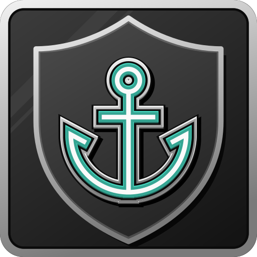

#  Loskai

**Safe passage for your Docker deployments.**

[](CHANGELOG.md)
[](LICENSE)

A web control panel for your homelab, run as one Docker container. It sits beside the tools
you already use, Docker, Caddy, AdGuard and SSH, and drives them for you.


## Features

- **HTTPS names.** One step adds a Caddy route and an AdGuard DNS entry, so
  `192.168.10.20:8096` opens as `https://jellyfin.home.lan`.
- **Local certificates.** Caddy issues them from its own certificate authority: no domain to
  buy, nothing exposed to the internet. Each device trusts it once, from Loskai's
  **Certificate** page.
- **Docker stacks.** Start, stop, update and edit them, with the logs and a terminal for each
  container.
- **Apps from recipes.** Jellyfin, Immich, Forgejo and more, installed from a form.
- **Machines over SSH.** Name the machines on your network, see what runs on each and which
  updates wait, and open a terminal in the browser.
- **Dashboard.** A card for each service, open without logging in.
- **Phone.** Every page works on a phone.
- **Settings** in the **Settings** tab, or in a `.env` beside `compose.yml`
  ([`.env.example`](.env.example)).
- **Docker socket.** Loskai mounts it, which is root on the host: give it to no other
  container. More in [SECURITY.md](SECURITY.md).

## Quick start

Loskai runs in Docker. You need a Docker host: a machine with
[Docker](https://docs.docker.com/engine/install/) and Compose, `amd64` or `arm64`, at a fixed
address.

On its own, Loskai manages your stacks and machines. HTTPS names, like
`https://jellyfin.home.lan`, also need [AdGuard Home](https://github.com/AdguardTeam/AdGuardHome)
for DNS and [Caddy](https://caddyserver.com) for HTTPS. Where those run is your setup:

| Setup | What runs where |
|---|---|
| [Loskai standalone](#loskai-standalone) | Loskai on your Docker host. No HTTPS names. |
| [Proxmox](docs/guides/install.md#proxmox) | AdGuard and Caddy in an LXC each, Loskai on your Docker host. |
| [Loskai + Caddy](docs/guides/install.md#loskai--caddy) | Loskai and Caddy on your Docker host, AdGuard on a small always-on machine like a Raspberry Pi. |
| [All-in-one](docs/guides/install.md#all-in-one) | Loskai, Caddy and AdGuard on your Docker host. DNS goes down when it does. |

### Loskai standalone

1. On the Docker host:

   ```bash
   mkdir loskai && cd loskai
   mkdir data stacks    # made by you, so Loskai doesn't run as root
   curl -fsSLO https://raw.githubusercontent.com/simplysunde/loskai/main/compose.yml
   docker compose up -d
   ```

2. Open `http://<docker-host>:8080` and fill in **Welcome to Loskai**. Leave **I want secure
   HTTPS connections** unticked.
3. Click **Start using Loskai**. You land on **Routing**.

To update: `docker compose pull && docker compose up -d` in Loskai's folder. Names can be
added later: [Add names later](docs/guides/install.md#add-names-later).

## A look around

**Docker** — a stack and its containers, then an app installed from its recipe and named.


**Machines** — a machine's overview, a service restarted in one click, and Claude Code
started in a project.


**On a phone** — the same pages, laid out for a small screen.


## Documentation

- [Install guide](docs/guides/install.md) — from nothing to your first name, step by step.
- [Using Loskai](docs/guides/using-loskai.md) — what each tab does.
- [Troubleshooting](docs/guides/troubleshooting.md) — 502s, redirect loops, DNS, certificates.
- [Everything else](docs/README.md) — every page, with when to read it.

## Contributing

Loskai is new: this is its first public release ([changelog](CHANGELOG.md)), and it runs
every day on its author's homelab. Issues and pull requests are welcome.
[CONTRIBUTING.md](CONTRIBUTING.md) has how to run it from source.

## License

[MIT](LICENSE). The tool icons are from [Simple Icons](https://simpleicons.org). The
[Git Logo](https://git-scm.com/downloads/logos) by Jason Long is licensed under the
[Creative Commons Attribution 3.0 Unported License](https://creativecommons.org/licenses/by/3.0/).
