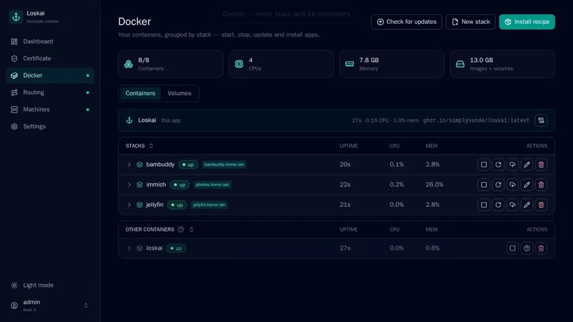

# Loskai

**Safe passage for your Docker deployments.**

[](CHANGELOG.md)
[](LICENSE)

A control panel for your homelab, in one container: an HTTPS name for every service, your
Docker stacks, apps from recipes, and your machines over SSH.


## Features

- **HTTPS names in one step.** `https://jellyfin.home.lan` instead of `192.168.10.20:8096`:
  one step adds the Caddy route and the AdGuard DNS entry.
- **Docker stacks.** Start, stop, update and edit them, with the logs and a terminal for
  each container.
- **Apps from recipes.** Jellyfin, Immich, Forgejo and more, installed from a short form and
  named in the same dialog.
- **Machines over SSH.** Name the computers on your network, see what runs on each and
  which updates wait, and open a terminal in the browser.
- **A dashboard for everyone.** Every service as a card, no login needed.
- **On a phone too.** Every page, not only the dashboard.

## Quick start

You need [Docker](https://docs.docker.com/engine/install/) with Compose, on an `amd64` or
`arm64` machine.

1. Start Loskai:

   ```bash
   mkdir loskai && cd loskai
   mkdir data stacks    # made by you, so Loskai runs as you and not as root
   curl -fsSLO https://raw.githubusercontent.com/simplysunde/loskai/main/compose.yml
   docker compose up -d
   ```

2. Open `http://<docker-host>:8080`. You see the **Dashboard**, still empty.
3. Click **Log in** and fill in **Create the admin account**. You land on **Routing**.

The **Docker** tab works right away, with your containers already listed. **Machines** asks
for a domain first: **Settings** › **Base Domain** (`home.lan` will do). Names take a little
more: see [HTTPS names](#https-names).

To update, run `docker compose pull && docker compose up -d` in that folder. A `.env` beside
`compose.yml` can hold the settings instead of the **Settings** tab
([`.env.example`](.env.example)).

Loskai mounts the Docker socket, which is root on the host: give it to no other container.
More in [SECURITY.md](SECURITY.md).

## HTTPS names

Names take two more pieces, and Loskai drives both once they are up:
[Caddy](https://caddyserver.com) serves each name over HTTPS, and
[AdGuard Home](https://github.com/AdguardTeam/AdGuardHome) answers its DNS. The
[install guide](docs/guides/install.md) sets them up step by step: with Proxmox, without
it, or all on one box.

The certificates come from Caddy's own certificate authority, so there is no domain to buy
and nothing is exposed to the internet. Each device trusts it once, from Loskai's
**Certificate** page.

## A look around

**Docker** — an app installed from its recipe, and named.



**Machines** — a machine's overview, and a terminal on it.


**Dashboard** — on a computer and on a phone.


## Documentation

- [Install guide](docs/guides/install.md) — from nothing to your first name, step by step.
- [Using Loskai](docs/guides/using-loskai.md) — what each tab does.
- [Troubleshooting](docs/guides/troubleshooting.md) — 502s, redirect loops, DNS, certificates.
- [Everything else](docs/README.md) — every page, with when to read it.

## Contributing

Loskai is new: this is its first public release ([changelog](CHANGELOG.md)), and it runs
every day on its author's homelab. Issues and pull requests are welcome.
[CONTRIBUTING.md](CONTRIBUTING.md) has how to run it from source.

## License

[MIT](LICENSE). The tool icons are from [Simple Icons](https://simpleicons.org). The
[Git Logo](https://git-scm.com/downloads/logos) by Jason Long is licensed under the
[Creative Commons Attribution 3.0 Unported License](https://creativecommons.org/licenses/by/3.0/).
