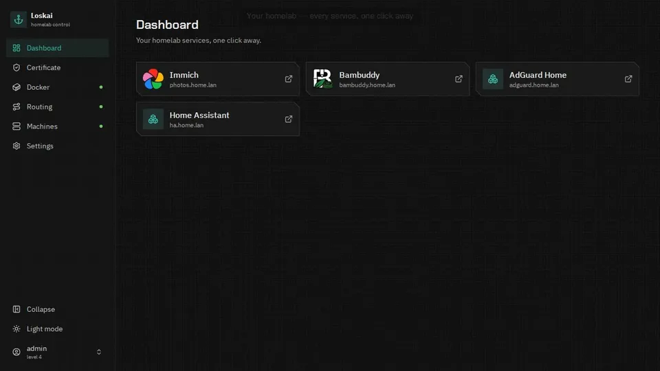
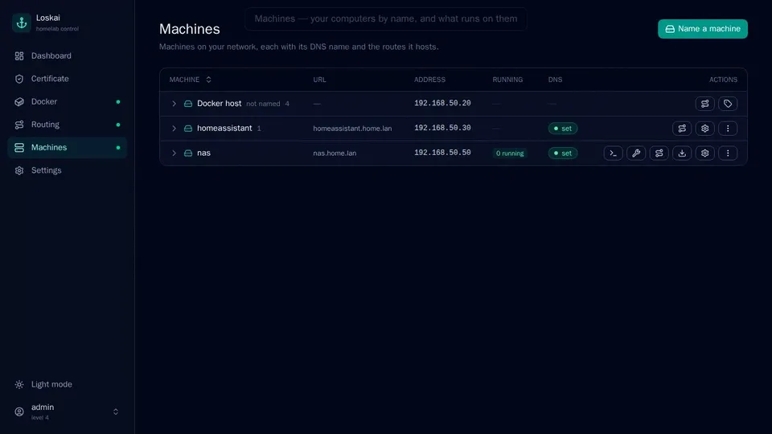
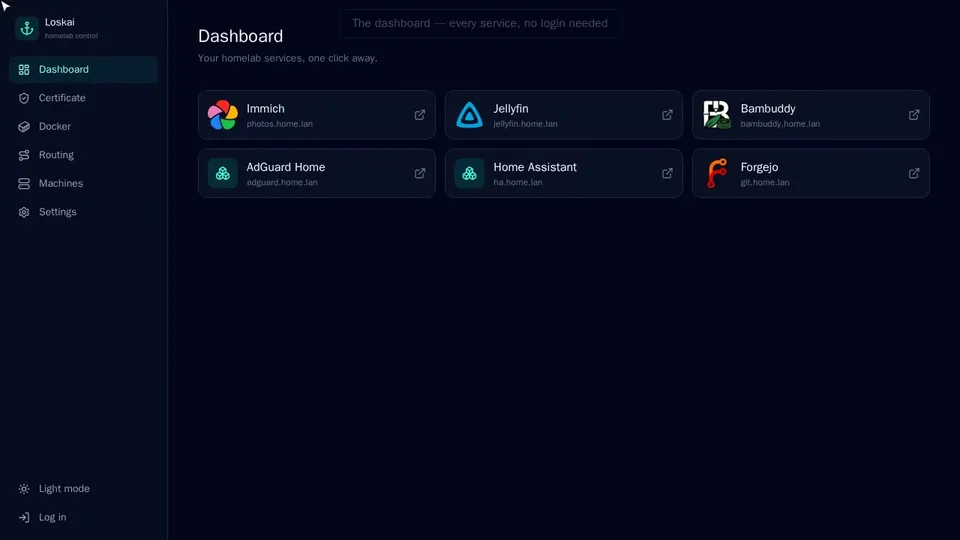
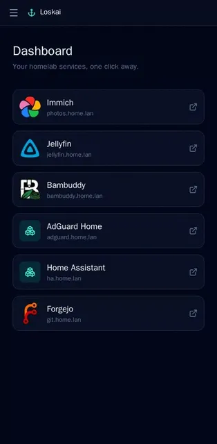

# Loskai

**Safe passage for your Docker deployments.**

A control panel for your homelab, in one container. Give every service an HTTPS name in one
step, run your Docker stacks, install apps from recipes, and look after the machines on your
network over SSH — from a computer or a phone.



## What it does

**A name for every service.** `https://jellyfin.home.lan` instead of `192.168.10.20:8096`.
One step adds the Caddy route and the AdGuard DNS entry together.

**Apps from recipes.** Your containers, grouped by stack: start, stop, update, edit. Install
an app from a recipe and name it in the same dialog.


**Your machines, over SSH.** Name the computers on your network and see what runs on each,
with its updates, its tools and a terminal in the browser. Routes on a machine move with it
when its address changes.



**A dashboard for everyone.** Every service as a card, no login needed.




## Get started

You need Docker with Compose, on an `amd64` or `arm64` host.

```bash
mkdir loskai && cd loskai && mkdir data stacks   # yours, so Loskai runs as you, not root
curl -fsSLO https://raw.githubusercontent.com/simplysunde/loskai/main/compose.yml
docker compose up -d
```

Open `http://<docker-host>:8080` and create the admin account. Docker, Machines and the
dashboard work from here.

**HTTPS names** also need [Caddy](https://caddyserver.com) and
[AdGuard Home](https://github.com/AdguardTeam/AdGuardHome), which Loskai drives through their
APIs. The [install guide](docs/guides/install.md) sets them up, in one of three layouts:

| Layout | Caddy and AdGuard | Compose file |
|---|---|---|
| **A** — with Proxmox *(recommended)* | Each in its own LXC, made by a script | `compose.yml` |
| **B** — without Proxmox *(recommended)* | AdGuard on a small always-on box, Caddy beside Loskai | `compose.caddy-loskai.yml` |
| **C** — one box | All three in Docker; the host's port 53 must be freed first | `compose.colocated.yml` |

The certificates come from Caddy's own certificate authority, so no domain needs buying and
nothing is exposed to the internet. Each device trusts it once, from Loskai's
**Certificate** page.

**Update:** `docker compose pull && docker compose up -d`. Every setting is in the UI; a
`.env` beside `compose.yml` can set them instead ([`.env.example`](.env.example)).

Loskai mounts the Docker socket, which is root on the host: give it to no other container.
More in [SECURITY.md](SECURITY.md).

## Documentation

- [Install guide](docs/guides/install.md) — from nothing to your first name, step by step.
- [Using Loskai](docs/guides/using-loskai.md) — what each tab does.
- [Troubleshooting](docs/guides/troubleshooting.md) — 502s, redirect loops, DNS, certificates.
- [Everything else](docs/README.md) — every page, with when to read it.

## Status

0.1.0 is the first public release ([changelog](CHANGELOG.md)). It runs every day on its
author's homelab. Issues and pull requests are welcome — [CONTRIBUTING.md](CONTRIBUTING.md)
has how to run it from source.

## License

[MIT](LICENSE). The tool icons are from [Simple Icons](https://simpleicons.org). The
[Git Logo](https://git-scm.com/downloads/logos) by Jason Long is licensed under the
[Creative Commons Attribution 3.0 Unported License](https://creativecommons.org/licenses/by/3.0/).
