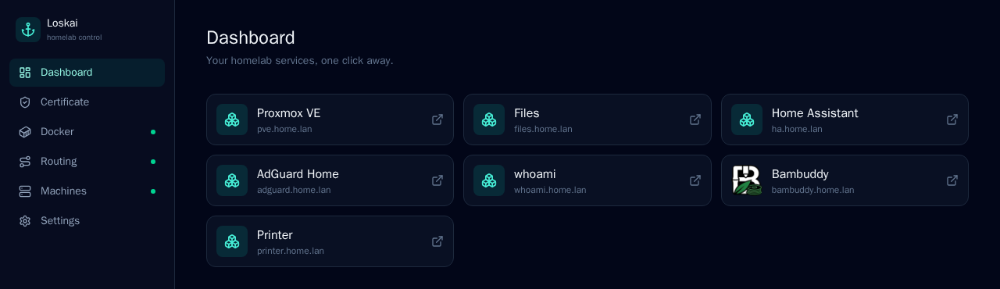
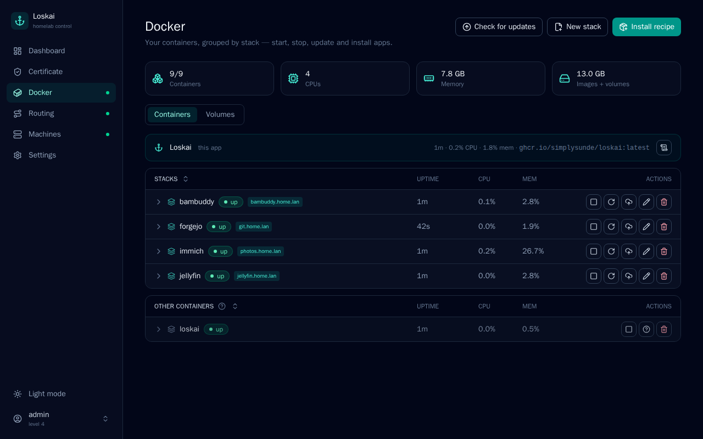
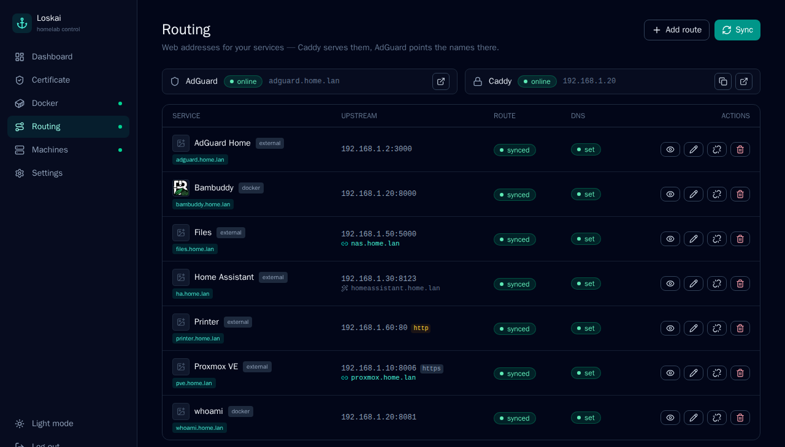

[Docs](../README.md) › [Guides](../README.md#guides)

# Using Loskai

**Read this when** the install is done and you want to know what each tab is for.

One section per tab, each with an example. The examples use `home.lan` as the base
domain and `192.168.10.20` as the Docker host.

## The idea in one paragraph

Every service gets a name like `jellyfin.home.lan`. **Caddy** answers that name and
forwards to the service (the *route*); **AdGuard** tells your devices where the name lives
(the *DNS rewrite*). Loskai does both in one step and remembers it in `data/instances.json`.
Nothing else is stored.

## Dashboard

A launcher: one card per routed service, public so the whole household can use it. Hide a
card with the eye on its Routing row; give it an icon with the image button on the same row.

## Certificate

Loskai's names use Caddy's own certificate authority, which your devices don't trust yet.
This page hands out that certificate with install steps per OS. Once per device — see
[certificate-setup.md](certificate-setup.md).

## Docker

Your containers, grouped by compose project.

- **Stacks** are the projects Loskai manages, in `stacks/<name>/`. Toggle up/down, restart,
  pull + update, edit, or delete — **Delete keeps `./data` unless you tick it**, so installing
  again picks the data back up. Edit opens as a form: **Settings** (the `.env`, labelled
  with the recipe's questions), **Folders** (host folder → path in the container, writable or
  not), the recipe's **Options** (a GPU for transcoding, say — off until ticked) and **App** —
  what `compose.yml` runs, shown but not edited, since it is the recipe's.
  **Edit as text** opens the files themselves, a tab each; switching either way keeps what
  you haven't saved yet. **Save** — greyed out until something changed — saves and
  re-ups the stack.

  > *Example:* to give Jellyfin another library, Edit → Add folder → `/srv/media/books` →
  > `/media/books` → Save.
- **Other containers** were started elsewhere (another compose folder, `docker run`).
  Start, stop and remove work; editing doesn't — the files aren't Loskai's.
- **Volumes** lists Docker volumes and which containers use them. An unused one can be
  deleted.

**Install recipe** opens the catalog. A recipe is a ready-made `compose.yml` plus the
questions it needs answered. **Check for updates** lists what you installed from recipes and
marks the ones whose recipe has a newer version: open one to see what changes, then Update.
Only the recipe's `compose.yml` is replaced — your answers and `compose.override.yml` stay.

> *Example:* pick **Jellyfin**, add your media folder, press Install. Loskai writes
> `stacks/jellyfin/`, runs it, and offers a prefix — type `jellyfin` and it is live at
> `https://jellyfin.home.lan`.

Recipes come from git repos listed in **Settings › General**, plus any you drop into
`data/recipes/` ([recipe-schema.md](../reference/recipe-schema.md)).

## Routing

Every web address Loskai serves. Each row has two statuses: **Route** (Caddy has it) and
**DNS** (AdGuard has it).

**Add route** offers three sources:

| Source | For | Example |
|---|---|---|
| Container | a container on this host | `whoami` → `whoami.home.lan` → `192.168.10.20:8081` |
| Network service | AdGuard, your router, Caddy itself | `adguard.home.lan` → AdGuard's web UI |
| External | anything else with an IP and port | `nas.home.lan` → `192.168.10.50:5000` |

A container route can **follow its container** (on by default when Loskai can work out its
address): if it comes back on another port, the route is updated. Per route you can also
pick **HTTPS** (the default), **HTTP** for a device that can't trust the certificate, or
**Both**.

The two pills at the top: **AdGuard** shows whether DNS is reachable, and has a one-click
button to route AdGuard's own UI; **Caddy** shows the address every name answers with.

## Machines

The computers on your network, by name — a name with no port.

> *Example:* name `192.168.10.177` **proxmox** and it gets `proxmox.home.lan`. Add a route
> for its web UI on port 8006 *on that machine*. When the host moves to `.180`, edit the
> machine once and the route moves with it.

Under each machine are the routes on its address — however they were made. Moving the
machine moves them all, except a container route that follows its container.

## Settings

- **General** — base domain, the Docker host's IP, recipe sources, export a backup.
- **Network** — where Caddy, AdGuard and WireGuard are, and who sees the Certificate page.
  Each service is optional: one that is unset or down greys out only its own part of the UI.
- **Security** — the admin password.

---

**Next:** something not working? [Troubleshooting →](troubleshooting.md)
