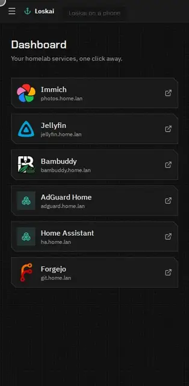
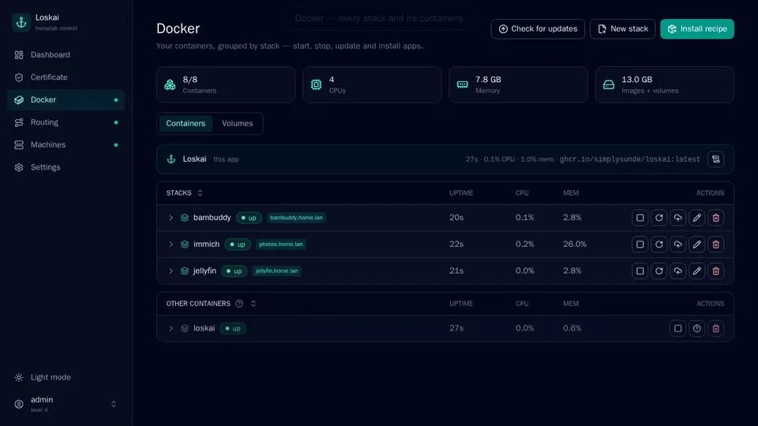
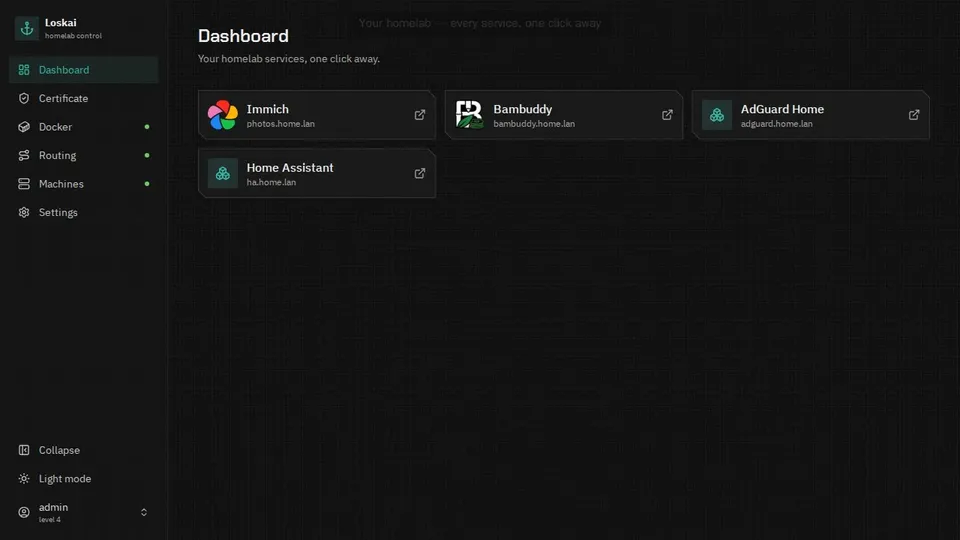
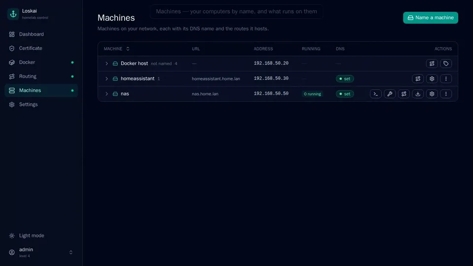

[Docs](../README.md) › [Guides](../README.md#guides)

# Using Loskai

**Read this when** the install is done and you want to do something in Loskai: install an
app, give a service a name, manage a machine.

One section per tab, a task at a time. The examples use `home.lan` as the base domain and
`192.168.10.20` as the Docker host. A button that is only an icon is named by what it says
when you point at it: the pencil (**Edit**).

| You want to | Go to |
|---|---|
| Add a user, change your password | [Your account](#your-account) |
| Install an app | [Install an app](#install-an-app) |
| Change an app's settings or folders | [Change a stack](#change-a-stack) |
| Give a service an HTTPS name | [Add a route](#add-a-route) |
| Put a service on the Dashboard by its address | [Add a link](#add-a-link) |
| Name a computer and manage it over SSH | [Name a machine](#name-a-machine), [Set up SSH](#set-up-ssh) |
| Update your machines | [Update a machine](#update-reboot-or-shut-down-a-machine) |
| Use git or Claude Code on a machine | [Git](#git), [Claude Code](#claude-code) |
| Find a setting | [Settings](#settings) |

## How it fits together

A service gets a name like `jellyfin.home.lan` in one step. **Caddy** serves the name over
HTTPS and passes it on to the service: the *route*. **AdGuard** answers the name for your
devices: the *DNS rewrite*. Loskai writes both. Without Caddy and AdGuard a service is a
*link*: its address, on the Dashboard.

**Dashboard** and **Certificate** are open to everyone on your network. **Docker**,
**Routing**, **Machines** and **Settings** need a login.

## Your account

The first account is made on the welcome page ([Install guide](install.md#choose-your-setup)) and is
an admin.

### Add a user

Only an admin can.

1. Open **Settings** › **Users** and click **Add user**.
2. Type a username and a password of at least 8 characters, and pick a level. Each level
   includes the ones before it:

   | Level | Reaches |
   |---|---|
   | **1 — Routing** | Routes and DNS names |
   | **2 — Docker** | Stacks, containers and recipe installs |
   | **3 — Machines** | Machines over SSH: terminals and tools |
   | **4 — Settings** | Settings, users and the logs: an admin |

3. Click **Add user**. The account is in the table.

On an account's row, the pencil (**Change their level**), the key (**Set a new password**)
and the trash (**Remove**) change it. A new password or a removal ends that user's sessions.
Loskai keeps one admin: the last one can't be removed or lowered.

### Change your password, or log out

Your name at the bottom of the sidebar opens a menu: your level, **Change password** and
**Log out**.

- **Change password** asks for the current one and the new one twice. You see **Changed.
  Your other devices are signed out.**
- **Log out** signs you out on every device and shows the Dashboard. **Log in** is where
  your name was.

You stay signed in while a Loskai page is open, even in a background tab, and are signed out
2 hours after the last one closes. An admin changes that in **Settings** › **Security**.

### Light or dark, a narrow sidebar, a phone

- **Light mode** or **Dark mode**, above your name, switches the theme in this browser. The
  look itself is for everyone: **Look** in **Settings** › **General**.
- **Collapse** narrows the sidebar to its icons. Point at one to see its name. The browser
  remembers.
- On a phone the sidebar is behind the menu button at the top.



## Dashboard

One card per route or link. A card opens its service in a new tab. Anyone on your network
can open the Dashboard without logging in. Machines get no card.

A card is changed on its row in **Routing**:

- **Hide it.** Click the eye (**Public on dashboard**). It turns into a crossed-out eye
  (**Private — hidden from dashboard**) and the card is gone.
- **Give it an icon.** Click the square left of the service's name (**Set a launcher icon**)
  and pick a PNG, JPEG or WebP of at most 512 KB. The square shows it at once.

## Certificate

Each device has to trust Caddy's certificate once, or every name opens with a warning. The
**Certificate** tab has the file and the steps for Windows, macOS, iPhone and Linux:
[Trust the certificate](install.md#trust-the-certificate).

The tab isn't there without Caddy. To hide it, or show it only once logged in:
[Hiding the tab](certificate-setup.md#hiding-the-tab).

## Docker

Your containers, grouped by stack. A **stack** is a folder in `stacks/` with a compose file:
those are the ones Loskai manages. Click a stack's name to see its containers.



### Install an app

A recipe is a ready-made compose file plus the questions it needs answered.

1. Click **Install recipe**. The catalog opens. The first time, it fetches the list.
2. Click an app, **Jellyfin** for example. **Review** shows what it will make. Click
   **Continue**.
3. Answer its questions. For Jellyfin, type your media folder under **Media folders**:
   `/srv/media/films`. A folder has to exist on the Docker host already, since Loskai never
   makes an empty one. Tick what you want under **Options**: hardware transcoding, say.
4. Click **Deploy**. You see **Deployed.** If it says **Finished with errors — check the
   output.**, **Output** shows what Docker said.
5. Under **Route it**, keep the name or type another, and click **Add route**. You see
   **Routed at** `https://jellyfin.home.lan`. Without Caddy the box is **Put it on the
   Dashboard**: click **Add link**.
6. Click **Done**. The stack `jellyfin` is under **Stacks**, and its files are in
   `stacks/jellyfin/`.

### Update an installed app

1. Click **Check for updates**. Each app installed from a recipe says **Update available**
   or **Up to date**.
2. Click one that says **Update available**. **What changed** lists what is new in its
   recipe.
3. Click **Update**. The row says **Up to date**.

An update replaces the recipe's `compose.yml` and adds a line to `.env` for a new question.
Your answers and `compose.override.yml` stay. If you changed `compose.yml` by hand, the app's
entry says so: move the change into `compose.override.yml` first, or the update replaces it.

For newer images of the same recipe, use **Pull + update** on the stack's row instead.

### Change a stack

1. On the stack's row, click the pencil (**Edit**).
2. Change what you need:
   - **Settings**: the answers you gave, kept in `.env`.
   - **Folders**: folders on the Docker host, and where each shows inside the container.
   - **Options**: the recipe's extras, off until ticked.

   The card at the top shows what the recipe runs: image, ports, data. It isn't changed
   here.
3. To give Jellyfin another library, click **Add folder**, type `/srv/media/books` (on the
   Docker host, where it already exists) and `/media/books` (in the container). Untick
   **Writable** to mount it read-only.
4. Click **Save**. It is greyed until something changed. The stack restarts with the change
   and the dialog closes.

If the stack doesn't start, the dialog stays open with what Docker said:
[A stack won't start after Save](troubleshooting.md#a-stack-wont-start-after-save).

**Edit as text** opens the files themselves, a tab each: `compose.yml`, `.env`,
`compose.override.yml`. **Edit as form** goes back. What you haven't saved comes along.

### Start, stop or restart a stack

The icons on a stack's row: **Compose up** or **Compose down**, **Restart**, and
**Pull + update**, which fetches newer images and restarts. The stack's pill says **up** or
**down**.

For one container, open the stack and click its **⋯**: **Stop**, **Restart**, **Remove**.

### Delete a stack

1. On the stack's row, click the trash (**Delete stack**).
2. Leave **Also delete its data** unticked to keep what the app stored in its folder.
   Installing it again picks the data back up. Ticked, the whole folder goes.
3. Click **Delete**. The stack is gone from the list.

The folders and options you added in **Edit** go either way: add them again after a
reinstall. Docker volumes stay: [Volumes](#volumes).

### Make a stack from your own compose file

1. Click **New stack**.
2. Type a name, and paste or write the compose file under `compose.yml`. Its variables go
   under `.env`.
3. Click **Create + up**. The stack is in the list.

### Read a container's logs, or open a terminal in it

Open a stack. On a container's row:

- **Logs** shows its last 200 lines, then follows it.
- **Terminal** opens a shell in it while it runs. The buttons above the shell each run one
  command: **List processes**, **Env vars**, **Disk usage**, **List files**, and what fits
  the image, such as **psql** on Postgres.

### Containers Loskai didn't start

Containers from another compose folder or from `docker run` are under **Other containers**.
They can be started, stopped and removed, and have **Logs** and **Terminal**. They can't be
edited: their files aren't Loskai's. To bring one in:
[Bringing your existing containers into Loskai](migration.md).

### Volumes

**Volumes**, beside **Containers**, lists Docker's volumes with their size and the
containers using each. One marked **unused** has a trash (**Delete volume**). Its data is
gone for good.

### Recipe sources

Recipes come from the git repositories under **Recipe sources** in **Settings** ›
**General**, and from any recipe folder you put in `data/recipes/`.

- To add a source, paste its address and click **Add**. Untick a source to switch it off.
  Where two sources have the same recipe, the first one listed wins.
- The catalog fetches a source the first time it opens. After that, **Refresh recipes** in
  the catalog gets what is new, and so does **Check for updates**.

To write a recipe: [recipe-schema.md](../reference/recipe-schema.md).

## Routing

One row per service: its name, where it runs, and whether Caddy and AdGuard have it.



### Add a route

1. Click **Add route**.
2. Say what to route:
   - **Container** lists the containers on the Docker host that have no name yet.
   - **Machines** lists what listens on each machine that has
     [SSH set up](#set-up-ssh), a port each.
   - Or type an address into **Host** and **Port**: `192.168.10.50` and `5000` for a NAS.

   Picking fills in the fields. **Clear** empties them again.
3. Check **Subdomain prefix**. `jellyfin` gives the address shown under the fields:
   `→ https://jellyfin.home.lan`.
4. Tick **Backend speaks HTTPS** for a service that serves HTTPS itself, like Proxmox on
   port 8006. Leave **Served over** on **HTTPS**, or choose **HTTP** or **Both** for a
   device that can't install the certificate: a TV, a printer.
5. Click **Add route**. You see `https://jellyfin.home.lan — route + DNS rewrite saved.`,
   and the row says **synced** under Route and **set** under DNS.

If the name doesn't open: [A name doesn't resolve](troubleshooting.md#a-name-doesnt-resolve),
[Certificate warning](troubleshooting.md#certificate-warning) or
[502 Bad Gateway](troubleshooting.md#502-bad-gateway).

**A container's route follows it**, where Loskai can tell its port. **Host** and **Port**
are filled in and locked, and Loskai changes them when the container comes back on another
port. **Set by hand** unlocks them.

**The Machines list** is there for an account with the Machines tab. It lists only what
Loskai can reach at the machine's own address. If a machine says **Its SSH user sees only its own
services' ports — root, or sudo, sees the rest.**, log in to it as root or give that user
`sudo` without a password. A Proxmox VM or LXC isn't listed: it is a machine of its own, so
[name it](#see-what-runs-on-a-machine). The Docker host's own containers are under
**Container**.

**AdGuard's own page** has a button of its own: the chain in the **AdGuard** pill
(**Route AdGuard**) makes it `adguard.home.lan` in one click.

### Read a row's status

| Column | Says | Means |
|---|---|---|
| Route | **synced** | Caddy has the route |
| | **not pushed** | Loskai has it, Caddy doesn't: click **Sync** |
| | **unknown** | Caddy can't be reached |
| DNS | **set** | AdGuard answers the name with the right address |
| | **missing** | AdGuard has no rewrite for it: click **Sync** |
| | **conflict** | AdGuard has another answer for the name too. Remove that one in AdGuard: Loskai never removes a rewrite it didn't write |
| | **unknown** | AdGuard can't be reached |

The **AdGuard** and **Caddy** pills above the table say **online**, **degraded**,
**unreachable** or **not configured**. Caddy's also shows the address every name answers
with. When one isn't online:
[A module shows unreachable](troubleshooting.md#a-module-shows-unreachable).

**Sync** sends every route to Caddy again and adds the rewrites AdGuard lacks. It says
**Synced.**, or **Sync didn't finish** and what didn't. Use it after Caddy or AdGuard was
reinstalled or unreachable.

A banner under the pills lists DNS warnings. Another lists each route whose container was
removed, with **Delete** beside it.

### Change or remove a route

On the route's row:

- The pencil (**Change URL**) opens the same fields. Change them and click **Assign**.
- The broken link (**Remove route**) takes the name away and keeps the row, which then says
  **not routed**. Its **+** (**Assign a URL**) gives it a name again, and the chain
  (**Make a link**) makes it a link.
- The trash (**Delete instance**) removes the row with its route and DNS rewrite.

None of them touches the service itself.

### Add a link

A link is a name and an address that the Dashboard opens directly: no HTTPS name, no Caddy,
no AdGuard.

1. Click **Add route**, then **Link**. Without Caddy the button says **Add link** and makes
   nothing else.
2. Pick a container, or type a **Name**, **Host** and **Port**. A container's link uses the
   Docker host's address and the port it publishes, and follows it like a route.
3. Tick **Opens over HTTPS** if the service serves HTTPS itself.
4. Click **Add link**. You see `http://192.168.10.20:8096 — link saved — on the Dashboard.`,
   and the row shows the address, tagged **link**.

On a link's row, the pencil (**Edit link**) changes it and the eye hides its card. With
Caddy, **+** (**Give it an HTTPS name**) turns it into a route, on the same row. A route
doesn't turn back into a link directly: remove the route, then click the chain on its row
(**Make a link**).

If it doesn't open:
[A link doesn't open, or can't be made](troubleshooting.md#a-link-doesnt-open-or-cant-be-made).

## Machines

The computers on your network, by name. A machine's name answers its address and has no
port, so it works for SSH, a file share, anything. With SSH set up, Loskai also opens a
terminal on the machine, shows what runs there and updates it.



### Name a machine

1. Click **Name a machine**.
2. Type a **Machine name** and its **Machine IP**: `nas` and `192.168.10.50`. Under the name
   you see `→ nas.home.lan`.
3. To manage it over SSH, type an **SSH user**: the user Loskai logs in as. Leave it empty
   for a name only.
4. Click **Name machine**. The machine's dialog opens and says `nas.home.lan — DNS rewrite
   saved.` With an SSH user, [Set up SSH](#set-up-ssh) opens over it.

The machine's row shows its name under **URL**. A tag beside it, **DNS missing**,
**DNS conflict** or **DNS unknown**, means the same as on
[Routing](#read-a-rows-status). With no tag, AdGuard answers the name. Point at the row for
the buttons that copy the name and the address.

**Routes on a machine.** A route whose address is the machine's is listed under it: click
the machine's name to open it. Closed, it shows how many. **Add a route**, in the ⋮ menu
(**More**) on its row, adds one. Give the machine another **Address** in its
dialog and its routes move with it, except a container's route that follows its container.

> *Example:* name `192.168.10.177` **proxmox** and it gets `proxmox.home.lan`. Add a route
> on it for its web page on port 8006, as `pve`. When the host moves to `.180`, change the
> machine's **Address** once: `pve.home.lan` goes on working.

**The Docker host**, where Loskai runs, is the first row before you name it: **Docker
host**, **not named**, at the **Docker Host LAN IP** from **Settings** › **General**. Click
the tag on its row (**Name it**) to name it. It is then a machine like the others, marked
**Host**.

### Set up SSH

Loskai logs in with a key of its own, as the user you give it. A `loskai` user with `sudo`
is a good choice, and root works.

1. Name the machine with an **SSH user**. For a machine you already named, click its cog
   (**Machine settings**), switch **SSH** on, type the user and click **Turn on**. The
   setup opens: **SSH —** and the machine's name.
2. Under **Is this the machine's host key?**, compare the fingerprint with what this prints
   on the machine, and click **Trust**:

   ```bash
   ssh-keygen -lf /etc/ssh/ssh_host_ed25519_key.pub
   ```

3. On your first machine you see **Loskai has no SSH key yet.** Type your own password and
   click **Create key**. That takes an admin.
4. Under **Install it for me**, type that user's password on the machine and click
   **Install**. It is used once and not kept. Or choose **I'll add it myself**, put the two
   lines shown in `~/.ssh/authorized_keys` on the machine, in place of any old lines ending
   in `loskai` or `loskai-status`, and click **Test connection**.
5. You see **Loskai logs in with its key.** and how much is running. Click **Done**.

The machine's row now has **n running**, a button for each [tool](#tools) it has, and a
terminal beside the cog. If a step fails:
[A machine over SSH](troubleshooting.md#a-machine-over-ssh).

**Your password unlocks the key.** The first thing you do that needs it opens **Unlock
Loskai's key**: type your Loskai password and it goes on. The key stays unlocked for 15
minutes. **Settings** › **SSH** changes how long, up to 24 hours, and whether it asks at
all.

### Open a terminal on a machine

Click the terminal icon on the machine's row, or **Terminal** in its dialog. The keyboard
icon at the top lists its keys:

- Ctrl+Shift+C copies what you selected, and Ctrl+V pastes.
- Shift+drag selects where a program uses the mouse itself: tmux, Claude Code.
- What a program copies, in tmux or Claude Code, lands on your clipboard.

The copy icon beside it copies everything the terminal shows, to paste an error whole. It is
on every terminal, the drop-down one too.

### A machine's dialog

The cog on a machine's row (**Machine settings**) opens it. The menu down its side jumps to
a section, and **Search** finds one by what is in it.

| Section | What is there |
|---|---|
| **General** | **Machine name** and **Address**. Then what the machine says about itself: system, uptime, updates waiting, its Tailscale address, memory, disks. Beside that, **Update**, **Reboot** and **Shut down** |
| **SSH** | A switch that turns it on or off. **Login**: the user and port. **Keys**: **SSH setup**, to run the setup again — **Install again** when its status needs it. **Updates without a password** |
| **Tools** | A card per [tool](#tools), and **Add tool** |
| **Running** | What runs there, with **Restart** and **Stop** |
| **Log** | Every terminal and run on this machine. An admin's |

A field saves when you press Enter or leave it, and Escape puts it back. A value that isn't
valid says why and saves nothing.

A machine's cog turns amber when Loskai can't read its status, or reads it from a status
line older than this Loskai; its tooltip says which. In the dialog, **Keys** under **SSH** says
**out of date** or **can't be read**: click **Install again** there, then **Install**. Loskai's
own key does it, with no password; only if the machine refuses that key, type the machine's
password, as in step 4 of [Set up SSH](#set-up-ssh).

### See what runs on a machine

Click **n running** on the machine's row. It lists the machine's containers, its services
and, on Proxmox, its VMs and LXCs.

- Each port is one chip. **:8080** copies the machine's address with that port, like
  `192.168.10.50:8080`; its **+** opens [Add route](#add-a-route) with that port filled in.
  A port that has a route has the route's icon in place of **+**: it opens the route, and
  shows its name on hover.
- **Name**, on a Proxmox VM or LXC, opens [Name a machine](#name-a-machine) with its name
  and address filled in. A VM's address comes from its QEMU guest agent. Without one, type
  it.

To restart or stop something, open the machine's dialog at **Running**: **Restart** and
**Stop** on a service or container, **Reboot** and **Shut down** on a Proxmox VM or LXC.
Each asks first.

If the list says the user **may not list containers**, add the user to the `docker` group,
log in as root, or give the user `sudo` without a password for everything. Loskai doesn't
use a narrower `sudo` rule.

### Update, reboot or shut down a machine

1. Click **Update system** in the ⋮ menu (**More**) on the machine's row, or **Update** in
   its dialog. It refreshes
   the package lists and installs every update, with the machine's own package manager.
2. If `sudo` needs a password there, a dialog asks for it. Type it and click **Run**. It is
   checked on the machine and used for this run only.
3. A panel drops down from the top of the page: **Running…**, then **Done**, with the run's
   last lines. It closes by itself after three seconds. Point at it to hold it, or click **Keep open**. If it says
   **Failed**, it stays, with the output.

**Reboot** and **Shut down** are in the same ⋮ menu, and in the dialog under **General**.
Each asks first.

### Updates without a password

1. In the machine's dialog, under **SSH**, switch **Updates without a password** on.
2. Type the user's `sudo` password once and click **Run**. You see **Done: Update no longer
   asks for a password.**

This puts a `sudo` rule on the machine that lets Loskai's user run the update commands, and
take the rule off again, without a password. It allows nothing else. Switching it off
removes the rule and asks for no password. Where Loskai logs in as root there is nothing to
switch.

### Update every machine

**Update all** is above the machines once one has SSH set up.

1. Click **Update all**. Each machine says how many updates wait, and has its own
   **Update** and its **Passwordless sudo** switch, which is
   [Updates without a password](#updates-without-a-password).
2. Click **Update all**. The machines update one after another, each asking for its `sudo`
   password where it needs one.

**Stop after this one** leaves the rest. A machine that fails holds the others until you
close its panel. What waits on a machine is read again when its run ends.

### Tools

A tool adds a card to a machine's dialog, under **Tools**, where the machine has its
program: **Git**, **Claude Code**, **Tailscale**, **tmux**.

- **Add one.** Click **Add tool** and pick it. Each says what it installs.
- **Open one from the list.** A machine's row has a button for each tool it has. Git,
  Claude Code and tmux share one, **Projects**: it opens the machine's projects with all
  their buttons together (**Pull**, **Push**, **Start**, **Attach**, **Session**), its
  tmux sessions, and at the foot **Pull all**, **Push all**, **Clone**, **New project** and
  **New session**, as far as the machine has those tools. Point at a button to see how it
  stands there, such as **2 projects, 1 running · 1 tmux session**. A small number in its
  corner counts the sessions running. It turns amber when something there waits on you: a
  Claude session stopped at a question, or Tailscale logged out or waiting for approval.

Point at a tool's button to see the command it runs. Some run by themselves in the panel at
the top, like an update. The others open a terminal, where you answer what the program asks:
`sudo`, a login. With tmux on the machine, an update, a pull or a clone keeps running if you
close the tab, and clicking its button again picks it back up.

#### tmux

The card lists the machine's tmux sessions. Claude's are on their projects instead.

- **Attach** opens one in the terminal. Ctrl+B, then D, leaves it running.
- **End** ends it, after asking.
- To start one, type a name and click **New session**.
- On a machine without Claude Code, each project has **Session** too: its own tmux session,
  opened in the project's folder, and started first when it isn't running. The project says
  **running** while it is, and **End** beside it ends it, after asking. Where Claude Code
  is, its **Start** and **Attach** are the project's session instead.

#### Tailscale

Tailscale lets your devices reach your homelab from anywhere. Its card has two switches:

- **Connected** puts the machine on your tailnet. The first time, the terminal shows a link
  to log it in.
- **Share this network** shares the machine's network with your tailnet. It needs two
  settings in Tailscale's admin console as well.

All the steps: [From the Machines tab](tailscale.md#from-the-machines-tab).

#### Git

The card lists the git projects in the machine's projects folder, `~/projects` unless you
change it.

- **Say who commits are by.** Click **Settings** on the card, fill in **Name** and
  **Email**, and click **Save**. **Projects folder** is there too. The card's header then
  says `as` and the name.
- **Work on a project.** Each has **Pull**, which only fast-forwards, **Push**, and
  **Terminal**, a shell in it. **Pull all** and **Push all** do every project that has
  something to pull or push. Pulls and pushes drop down from the top of the page and say
  **Done** or **Failed**, with git's last lines. A project's first **Push** to its
  **Remote** sets the branch to follow it, so a new project needs nothing more.
- **Get a project.** Paste a repository's address beside **Clone** and click it.

These run in the machine's terminal as its SSH user. Over HTTPS a public repository just
works, and a private one asks for its login in the terminal. An address with a login or
token in it (`https://token@github.com/…`) is refused, since addresses are written to the
SSH log. Over SSH the machine needs a
key of its own that GitHub or your Forgejo knows, and the first time it asks you to trust
that host's key. Loskai's key never leaves Loskai.

**Give the machine a key for GitHub or Forgejo**

1. On the Git card, click **Keys**, then **Add SSH key**.
2. **Site**: pick GitHub, GitLab or Codeberg. For a Forgejo or Gitea of your own, pick
   **Add a site…** and fill in its name, its web address (`http://192.168.10.30:3000`) and
   its SSH address, filled in from the web address: add `:port` when its SSH isn't on 22
   (`192.168.10.30:222`), as when Docker publishes it on another port. Every machine offers
   it from then on.
3. **Key name**: how the site lists the key, `you@machine` to start with. Click **Make the
   key**, or **Rename the key to …** when the machine has one by another name. The key has
   no passphrase, so pulls and pushes run unattended, and its private half stays on the
   machine.
4. Click **Copy**, then **Paste it in GitHub's SSH keys**, which opens that page on the
   site. Paste it there and save.
5. Click **Test**. **It gets in.** means it works; **Refused** means the site doesn't have
   it yet.

An account key reaches every repository your account can, on every site you add it to.

**What Keys lists**

**Keys** lists the keys in the machine's `~/.ssh` that git uses, under the name a site lists
each by, with its file beside it and what uses it, such as **Fetches and pushes loskai**:

- **Account keys** and **Deploy keys**.
- **Not used by git yet**: a key no remote uses and no label claims, such as a new machine's
  `id_ed25519` before its first clone over SSH. **Label** one that is git's to move it up.

On each row:

- **Copy** copies a key's public line.
- **Label** writes on the key what it is for: an account, one project, or logging in to other
  computers. The key itself doesn't change and goes on working where it was added. A key
  labelled for logging in to other computers isn't git's, so **Keys** stops listing it.
- **Delete** removes its file for good. GitHub or Forgejo still lists the key until you take
  it off there. A key that `~/.ssh/config` names can't be deleted here: take it out of that
  file first.

Loskai's own key isn't in **Keys**: it lets Loskai in to the machine, and is in **SSH setup**.

If **Keys** says `~/.ssh/config` names a key Loskai can't find here, check `~/.ssh` for it.
If it's gone, fix that line in `~/.ssh/config` or delete its `Host` block: `ssh` may not use
another key in its place, so that host refuses the machine.

**Give one project a key of its own**

A deploy key reaches one repository only: a good choice on a machine where Claude works by
itself.

1. On the project's row, click the cog (**Project settings**), then **Give it its own
   key**. A terminal shows the key.
2. Add it to the repository on GitHub or Forgejo, under Settings › Deploy keys, with write
   access if the project pushes.

**Back to the machine's key**, in the same place, undoes it. The button waits while the
project has no remote over SSH: over HTTPS no SSH key is used.

A project's own **Name** and **Email** are in **Project settings** too, kept in that clone
only. Empty, the card's apply; while one is set, or its own key, the cog is teal.

**Remote**, there too, is where the project's **Pull** and **Push** go (git's `origin`):
type an address, `git@github.com:you/project.git` or `https://…`, and click **Save**. A
project without one gets it added. To remove a remote, use the project's **Terminal**.

**Find the key a host takes**

In **Keys**, each key's row has a host field and **Test**. Click into the field: it lists
the hosts you tested on before, then the git sites, then **Add a site…** for one of your own.
Pick one, or type the host, and click **Test**: it tries that key alone and says whether it gets in, and as
whom. A key with a passphrase isn't tried.

#### Claude Code

The card lists the same projects as Git, one Claude session each, with each project's
branch, what isn't pushed or committed, and when Claude last worked there. Pull, push and a
shell are on the Git card.

- **Start** runs Claude in the project, in the background, and continues its last
  conversation. Remote Control is on, so you carry on from the Claude app or
  claude.ai/code.
- **Attach** shows the running session in the terminal. Ctrl+B, then D, leaves it running.
- **Stop** ends the session, after asking. The conversation stays, and **Start** continues
  it.

If Start says **Claude asks whether to trust** the project first, click **Attach** and
answer it there. Until someone does, that project's **Attach** is amber, for everyone and on
every device. If it says **Claude isn't logged in on this machine**, open a **Terminal**,
run `claude`, and log in with `/login`; then click **Start** again.

Under the list: type a name and click **New project** to make a folder with a git
repository and open Claude in it. **Update Claude** updates Claude Code: a running session
keeps its version until it is stopped and started. **Stop all** stops every Claude session,
and no tmux session of your own.

Claude Code has to be logged in on the machine. The first time, open the machine's
**Terminal**, run `claude` and log in. Loskai holds no Claude login.

### Projects on every machine

**Projects** is above the machines once one has SSH set up. It lists each machine that has
projects and, per project, its branch, what isn't pushed or committed, its last commit and
its Claude session, with the buttons of both cards: **Pull**, **Push**, **Terminal**,
**Attach**, **Start** or **Stop**, and its cog, **Project settings**. Under a machine's
projects are its tmux sessions.

- The strip of machines across the top jumps to one. **Search** finds a machine by its
  name, showing all its projects, or a project by its name, showing just that project on
  each machine that has it. A machine that can't be read says why at the top.
- **Machine**, beside a machine's name, opens its dialog. Closing it comes back.
- **New project** makes one on the machine you pick: a new folder with Claude opened in it,
  or a clone of a repository.

### Turn SSH off, or delete a machine

- **Turn SSH off.** In the machine's dialog, switch **SSH** off and click **Turn off**.
  Loskai's access comes off the machine. The machine keeps its name.
- **Delete it.** Click **⋮** (**More**) on its row, then **Delete machine** and **Delete**.
  Its name goes, and Loskai's access is taken off the machine first. The routes on its
  address stay and go on working.

A machine that can't be reached is deleted anyway. A banner then says what to remove from
it by hand. Adding the machine again later installs the same key.

## Settings

Settings is an admin's. A field saves when you press Enter or leave it. One that the
compose file or `.env` sets is locked and marked **env**:
[Environment variables](deployment.md#environment-variables).

| Page | What is there |
|---|---|
| **General** | **Base Domain**; **Docker Host LAN IP**; **Docker Host Tailscale IP**, for [a machine on your tailnet](tailscale.md#managing-a-machine-on-your-tailnet); **Look**; [**Recipe sources**](#recipe-sources); **Export config**, a file of your routes and DNS rewrites |
| **Network** | Where AdGuard, Caddy and WireGuard are. Each is optional. **Certificate page in the sidebar**. Under WireGuard, the DNS server to give each peer |
| **SSH** | **Loskai's key**, with its fingerprint and **New key**; **Ask for your password**; **Keep the key unlocked for**; **SSH config**, your machines in a file for the `ssh` on your own computer |
| **Users** | [The accounts](#add-a-user) |
| **Security** | **Sign out this long after the last page closes**: 2 hours unless you change it |
| **Logs** | **Sign-ins**: each sign-in and wrong password, never the password. **SSH**: terminals, runs and installs, never what was typed |

**New key** replaces Loskai's SSH key. Every machine then needs its
[SSH setup](#set-up-ssh) run again.

**Ask for your password** set to **No** lets anyone signed in with the Machines tab use the
key at once. That is fine for one person on a home network or tailnet over HTTPS, and not
for a Loskai that can be reached from the internet.

**Clear rewrites**, under **Network**, is for an AdGuard that had rewrites before Loskai.
It deletes every rewrite in AdGuard, the ones you added by hand too, and writes Loskai's
back. A dialog lists what will be lost before you click **Clear and restore**.

---

**Next:** something not working? [Troubleshooting →](troubleshooting.md)
