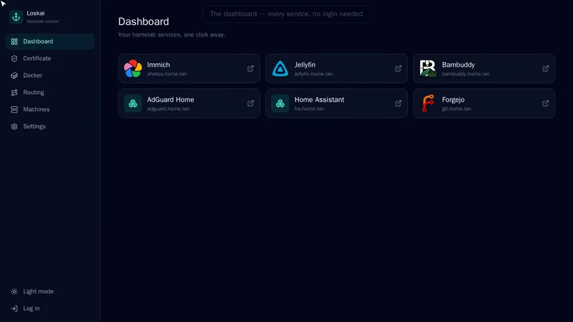

[Docs](../README.md) › [Guides](../README.md#guides)

# Using Loskai

**Read this when** the install is done and you want to know what each tab is for.

One section per tab, each with an example. The examples use `home.lan` as the base
domain and `192.168.10.20` as the Docker host.

## The idea in one paragraph

Every service gets a name like `jellyfin.home.lan`. **Caddy** answers that name and
forwards to the service (the *route*); **AdGuard** tells your devices where the name lives
(the *DNS rewrite*). Loskai does both in one step and remembers it in `data/instances.json`.
The rest of `data/` is its settings, accounts, SSH keys, logs and launcher icons — no
database.

## Accounts

The first time you open Loskai it asks you to create the **admin** account — a username and a
password. In **Settings › Users** an admin adds more, each with a **level**; each level
adds to the ones before it:

1. **Routing** — routes and DNS names.
2. **Docker** — stacks, containers and installing apps.
3. **Machines** — the machines over SSH: terminals and tools.
4. **Settings** — Settings, users and the logs: an admin, who can do everything.

You stay signed in while a Loskai page is open, even in a background tab, and are signed
out 2 hours after you close the last one (an admin changes that in Settings › Security).
Your name at the bottom of the sidebar opens a menu: your level, **Change
password**, and **Log out**, which signs you out on every device and back to the
Dashboard; **Log in** is in its place then. **Light mode** / **Dark mode** above it switches
the theme, and **Collapse** above that narrows the sidebar to its icons — each tab named
when you point at it — until you expand it again; the browser remembers which. On a phone
the sidebar is a drawer, opened with the menu button at the top.

## Dashboard

A launcher: one card per routed service or link, public so the whole household can use it.
Hide a card with the eye on its Routing row; give it an icon with the image button on the
same row. A desktop app can build shortcuts from the same list (`GET /api/launcher`).

## Certificate

Loskai's names use Caddy's own certificate authority, which your devices don't trust yet.
This page hands out that certificate with install steps per OS. Once per device — see
[certificate-setup.md](certificate-setup.md).

## Docker

Your containers, grouped by compose project.

- **Stacks** are the projects Loskai manages, in `stacks/<name>/`. Toggle up/down, restart,
  pull + update, edit, or delete — **Delete keeps `./data` unless you tick it**, so installing
  again picks the data back up. Edit opens as a form: **Settings** (the `.env`, labelled
  with the recipe's questions), **Folders** (host folder → path in the container, writable or
  not), the recipe's **Options** (a GPU for transcoding, say — off until ticked) and **App** —
  what `compose.yml` runs, shown but not edited, since it is the recipe's.
  **Edit as text** opens the files themselves, a tab each; switching either way keeps what
  you haven't saved yet. **Save** — greyed out until something changed — saves and
  re-ups the stack.

  > *Example:* to give Jellyfin another library, Edit → Add folder → `/srv/media/books` →
  > `/media/books` → Save.
- **Other containers** were started elsewhere (another compose folder, `docker run`).
  Start, stop and remove work; editing doesn't — the files aren't Loskai's.
- Each container has **Logs** and, while it runs, a **Terminal** — a shell in it, with
  one-click commands above it (processes, env vars, disk usage; `psql` on Postgres, say).
- **New stack** makes one from a `compose.yml` you paste or write.
- **Volumes** (the switch beside **Containers**) lists Docker volumes and which containers
  use them. An unused one can be deleted.

**Install recipe** opens the catalog. A recipe is a ready-made `compose.yml` plus the
questions it needs answered. **Check for updates** lists what you installed from recipes and
marks the ones whose recipe has a newer version: open one to see what changes, then Update.
Only the recipe's `compose.yml` is replaced — your answers and `compose.override.yml` stay.

> *Example:* pick **Jellyfin**, add your media folder, press Install. Loskai writes
> `stacks/jellyfin/`, runs it, and offers a prefix — type `jellyfin` and it is live at
> `https://jellyfin.home.lan`.

Recipes come from git repos listed in **Settings › General**, plus any you drop into
`data/recipes/` ([recipe-schema.md](../reference/recipe-schema.md)).

## Routing

Every web address Loskai serves. Each row has two statuses: **Route** (Caddy has it) and
**DNS** (AdGuard has it).

**Add route** has two lists to pick from, and fields that take any address:

| Pick from | For | Example |
|---|---|---|
| Container | a container on this host | `whoami` → `whoami.home.lan` → `192.168.10.20:8081` |
| Machines | a service or container on a machine with SSH set up, by the port it listens on | `proxmox.home.lan` → `192.168.10.10:8006` |
| (type it) | anything else with an IP and port | `nas.home.lan` → `192.168.10.50:5000` |

Picking fills in the fields; **Clear** empties them again for an address of your own.

Machines lists each machine's services by port, and only those Loskai can reach by the
machine's address (not one only on its Tailscale address, not Proxmox's VMs and LXCs — they
are machines of their own). Which service holds a port is something only root can read, so
the machine's SSH user needs `sudo` without a password, or to be root, to see all of them.
Its containers on this Docker host are the Container source instead. The WireGuard
dashboard and the Certificate page are typed in by hand; AdGuard has its own button (below).

A container route can **follow its container** (on by default when Loskai can work out its
address): if it comes back on another port, the route is updated. Per route you can also
pick **HTTPS** (the default), **HTTP** for a device that can't trust the certificate, or
**Both**.

The two pills at the top: **AdGuard** shows whether DNS is reachable, and has a one-click
button to route AdGuard's own UI; **Caddy** shows the address every name answers with.
**Sync** re-pushes every Caddy route and adds any missing or stale AdGuard rewrite. Below
the pills, a banner lists any DNS warnings, and another any route whose container was
removed, with **Delete** beside each.

On a row, **Remove route** takes its route and DNS rewrite away but keeps the entry, to
assign a URL again later; **Delete instance** removes the entry too. Neither touches the
service itself.

### Links

A **link** is a name and an address — `Jellyfin` at `http://192.168.10.20:8096` — that the
Dashboard opens directly: no HTTPS name, no Caddy route, no DNS rewrite. Add route offers
**Route** or **Link**; without Caddy set up (Loskai alone) it makes links only, and the install
wizard's last step offers one. A link to a container uses the Docker host's address and the
port it's published on — the one a browser can open — and follows the container like a route.

A link's row shows its address, tagged **link**: edit it with the pencil, hide it with the
eye, or give it an HTTPS name with **+** once Caddy is set up — it becomes a route, the same
entry. A route doesn't turn back into a link: remove the route, then add the link.

## Machines

The computers on your network, by name — a name with no port.

> *Example:* name `192.168.10.177` **proxmox** and it gets `proxmox.home.lan`. Add a route
> for its web UI on port 8006 *on that machine*. When the host moves to `.180`, edit the
> machine once and the route moves with it.

A machine's row has its name on the network under **URL**; while AdGuard doesn't answer
that name with its address, a **DNS missing** (or **DNS conflict**, **DNS unknown** while
AdGuard can't be read) tag sits beside it — set, nothing more is said. A small button after
the name and after the address copies it (shown as you point at the row; always on a phone).

Under each machine are the routes on its address — however they were made. A machine's
row opens and closes like a stack on the Docker tab, showing how many it holds while
closed. Moving the machine moves them all, except a container route that follows its
container.

The machine Loskai runs on is listed before you name it, as **Docker host**, from the
Docker host IP in Settings › General, with the routes on that address under it. **Name it**
(the tag on its row) opens Name a machine with its address filled in. Once it has a name
it is a machine like the others, with SSH, tools and its dialog. Named or not, it is always
the first row, tinted, and once named it carries a **Host** tag.

The **cog** on a machine's row opens its dialog, laid out like a settings window: every
section in one scroll, and a menu down the side that jumps to one and marks where you are.
Its search finds a section by what is in it and shows only those.

- **General** — its machine name (what DNS answers for) and address, then what the machine says
  about itself: system, uptime, memory, disks, updates waiting, its Tailscale address. Beside
  that, **Update**, **Reboot** and **Shut down** — the System tool's, done to the machine itself.
- **SSH** — a switch beside the heading turns it on or off, each in a dialog that says what
  happens. Then its user and port, side by side; whether it is set up (and the button to set
  it up); and the **updates without a password** switch.
- **Tools**, **Running** and, for an admin, **Log** — below.

Each field saves when you press Enter or leave it, and Escape puts it back; a value that
isn't valid says why and saves nothing. A machine set up before the overview existed says
**Install again** there — one click.

**Tools** add buttons to a machine's dialog — the ones that fit what the machine has, with
nothing to switch on, each as a card under its **Tools** — except **System**, which updates it
(with its own package manager), reboots it or shuts it down from **General**;
**Services** restarts or stops a service or container from the Running list; **Proxmox**
reboots or shuts down a running LXC or VM. Each runs in the machine's terminal, so you see
it; hovering a button shows the command. One that runs by itself — System's, Services,
Proxmox, ending a tmux session, Claude's Start and Stop, Tailscale's switches, adding a tool — asks first for
sudo's password in a dialog when sudo would, checks it on the machine, and runs in a small
terminal that drops down from the top of the page instead of a dialog. Done, it stays three
seconds so you can see what ran (hover to hold it, **Keep open** to keep it) and slides
away; a failure stays, with its exit code. The others (a shell,
tmux, attaching to Claude, connecting Tailscale) answer sudo in the terminal as usual. With
`tmux` on the machine it keeps running if you close the tab, and clicking it again picks it
back up.

A tool the machine doesn't have yet is under **Add tool**, on the right of the Tools
heading — each says what it installs, and picking one installs it, in the terminal. The **Tools** button (the wrench) on the machine's row in the
Machines tab lists the added tools — tmux, Git, Claude Code, Tailscale — with how each stands
there, and opens one in a dialog: the tool itself, or, if it isn't added yet, what it needs
and Add.

- **tmux** lists the machine's sessions — yours, and the ones Loskai's actions run in;
  Claude's are on their projects instead.
  **Attach** opens one in the terminal (detach with Ctrl+B, then D, and it keeps running),
  **End** ends it, and **New session** starts one with the name you type.
- **Tailscale** is installed with Tailscale's own installer. Its card is two switches:
  - **Connected** — on, it shows the machine's Tailscale address; off, **Logged out** or
    **Waiting for your tailnet to approve this device** say what it is waiting for.
    Switching it on brings Tailscale up in the terminal, which shows a link to log in the
    first time; off disconnects it, after asking.
  - **Share this network** — makes the machine a subnet router: it shares the network it
    is on (`192.168.10.0/24`) with your tailnet, so your devices reach your homelab from
    anywhere ([Tailscale](tailscale.md)). It says **waiting for approval** until you approve
    it in Tailscale's admin console (**Approve** goes there), then links to **Split DNS**.

  Both ask for sudo's password, except connecting, which answers sudo in the terminal. Under
  them, folded, the rest of your tailnet: each device, its address, and whether it is
  online. The overview shows the machine's Tailscale address too. In an LXC, Tailscale needs
  the container to have `/dev/net/tun`.

- **Git** holds who the commits made on the machine are by — its **Name** and **Email**,
  git's global `user.name` and `user.email` — and the machine's **projects folder**,
  `~/projects` unless you change it (`~` or one folder in it), behind **Settings** in its
  header: a dialog, read from the machine with Loskai's key (while it is locked, your
  password first), whose Save writes what you changed. Beside the card's summary, who the
  commits are by: `as Sunde`. It lists the git projects there, each with **Pull** (only when it
  fast-forwards), **Push** and **Terminal** (a shell in it), and a cog for the project's
  own **Name** and **Email** — set in its `.git/config`, in place of the global ones for
  that project only; empty, the global one applies (shown greyed), and the cog is teal
  while one is set. A fresh clone starts without them. Under the projects' buttons,
  **Pull all** pulls every project that has a remote, and **Push all** pushes every one
  with commits its remote doesn't have yet (as of the last fetch — Pull all fetches),
  and any without an upstream, which says so. **Clone** takes a repository's address — `https://…`,
  `ssh://…` or `git@host:path` — into the projects folder. They run in the machine's
  terminal as its SSH user, so the remote decides what happens there: over SSH, the
  machine needs its own key for that user added at the forge (Loskai's key never leaves
  Loskai), and the first time it asks you to trust the forge's host key; over HTTPS a
  public repository just works, and a private one asks for its login in the terminal.
  **Keys**, beside Settings in Git's header, lists the SSH keys of the user Loskai logs in
  as (`~/.ssh`, public halves only), in two lists: **Account keys** — on your account,
  reaching every repository you can: ssh's own (`id_…`), and a key for one platform, its
  platform beside it — and **Deploy keys**, on one repository each, its repository beside
  it (**Other keys**, when one is neither). Each says in a line a remote what it does —
  "Pushes projects › public/simplysunde.github.io · github.com via
  github-blog" — or why it is unused, and its comment and fingerprint
  (shortened; whole in its tooltip). Where it is used is every remote it is for, in
  every project and submodule — fetch, push, or both — by the project's own key, else by
  what ssh offers that remote's host, `~/.ssh/config`'s aliases included: a submodule that
  pushes through `git@github-site:…`, an alias naming its own key, shows under that key,
  "via github-site". A key `~/.ssh/config` names says so; Delete leaves it alone, since that
  file is yours. A key used only by a script that runs `ssh -i` itself can't be seen. An **account** key (`id_…`) goes on your
  GitHub or Forgejo account and reaches every repository you can; it is what a project
  without its own uses. A **deploy** key (`deploy_<project>`) goes on one repository and
  reaches only it. Each key has **Copy** — its public line, with its comment, onto the
  clipboard, ready to paste — and **Add to …** (GitHub, a host, repository), which opens where it goes: a deploy key's
  repository's Deploy keys page, worked out from its remote, or your account's SSH keys
  page on the platform its remotes are on (or its comment's "for <host>"). Then **Test**,
  which asks each remote the key is for for its HEAD with that key alone, as a pull would
  (only over SSH), and **Delete**, which asks first, removes the file and puts a
  project that used it back on the machine's key (GitHub or Forgejo still lists it until
  you take it off there). While there is no account key, **New account key** makes one
  (ed25519, no passphrase, so pulls and pushes run unattended; its private half never
  leaves the machine). Each key shows its comment, which says what it is for — Loskai's
  keys are made with one ("vm@codebox for github.com"; a deploy key's project) — and
  Loskai keeps nothing about a key itself: what it is for travels with it, where ssh uses
  it is read from your config, and whether a host takes it is a test you run. Under the
  list, one host field — `github.com`, `codeberg.org`, an alias, or `host:port` for a
  Forgejo whose SSH isn't on 22 — has three buttons. **Test key** tries the keys meant for
  that host, each on its own: the ones ssh offers it, and any whose comment says it is for
  it — a connection or two, saying which get in and as whom ("gets in as sunde"; a deploy
  key as its repository). **Try every key** tries every key, at most 10, to find which one
  a host takes when nothing says; each refused key is a failed login there, so on a
  self-hosted forge with fail2ban a few can get the machine banned for a while, and it
  stops as soon as the host stops answering. A key with a passphrase isn't tried. One key
  per platform is a `Host` block each in `~/.ssh/config`: **New key for a host** makes
  `~/.ssh/<host>` and prints the block to paste there — Loskai doesn't edit that file.
  Where ssh tries several keys on a host (no `IdentitiesOnly`), each shows as **offered**
  there. A project's cog says which key it uses;
  **Own key** there gives it a deploy key (set as its `core.sshCommand`, so git uses that
  key alone for it), its cog teal like its own name, and **Machine's key** goes back,
  keeping the file, so Own key takes the same key up again. On a machine Claude works on by
  itself, a deploy key keeps it to the one repository.
- **Claude Code** lists the git projects in the machine's projects folder, set in the Git
  card's **Settings**, with each one's
  branch, commits not pushed yet, uncommitted changes, last commit and when Claude last
  worked there. One Claude session per project, and its buttons follow it, in the same
  places on every row — **Attach**, then **Start** or **Stop**:
  - stopped: **Attach** is greyed; **Start** runs Claude in the background, the last conversation continued,
    else a new one, in tmux with **Remote Control** on, so you carry on from the Claude
    app or claude.ai/code. In a folder Claude was never told to trust, it stops at that
    question; Start says so, and **Attach** is where you answer it;
  - running: **Attach** shows the session, to watch it or take over (Ctrl+B, then D, leaves
    it running), and **Stop** ends it — the conversation stays, and Start continues it.

  At the card's foot, **New project** makes the folder, starts a git repository and opens
  Claude in it; **Update Claude** updates Claude Code (a running session keeps its version
  until stopped and started again); **Stop all** stops every project's session — not a
  tmux session of your own. Pulling, pushing and a shell in a project are on the Git card.
  Claude Code has to be logged in on the machine — the first time, do that in the
  terminal. Loskai holds no Claude login.

The tool cards come in one order on every machine: Git, Claude Code, Tailscale, tmux, then
any other.

Once a machine has SSH set up, a row above the machines holds what is done across them:
**Projects** and **Update all**.

**Update all** lists each such machine with the updates waiting on it and its own
**Update**, and updates them all one after another — System's Update on each, the next
starting once the last ends, each asking for its `sudo` password where it needs one
(without, under *Updates without a password* — its switch is beside each machine there
too, as **Passwordless sudo**, so Update all can go by without asking). **Stop after this one** leaves the rest.
What waits on a machine is read again as its run ends.

**Projects** follows work across machines: each machine with projects — its address and
Tailscale — with a table of its projects, each once: its git in columns (branch, commits
not pushed and uncommitted changes, last commit) and its Claude session together, and the buttons both cards give it: Pull, Push, Terminal, Attach, Start or Stop, run in that machine's terminal.
Under them is a table of its tmux sessions of your own (a Claude session is on its project), with
tmux's Attach and End. A strip of the machines across the top jumps to one, and its search finds one by a
project's name too. A
machine with no projects isn't listed; one that can't be read says why at the top.
**Machine** beside a machine's name opens its dialog over Projects — a project's own
settings are there — and closing it comes back to Projects.
**New project**, in the dialog's header, opens a dialog to make one on the machine you pick
— any with Claude Code or Git, projects or not: a new folder (Git started and Claude opened
in it) or a clone of a repository — then runs it in that machine's terminal.

A machine set up before a tool's facts existed asks you to **Install again** in its dialog —
one click, and its overview comes back with them.

Give a machine an **SSH user** and Loskai sets up SSH to it right after you save: check the
host key it shows against the machine's, then type that user's password once and Loskai
installs its key (**Install it for me**), or copy its two lines over yourself (**I'll add it
myself**). The first time, it says "Loskai has no SSH key yet." — an admin's password makes
it. Its dialog does this again, under SSH. Reaching a machine uses Loskai's key, which
your password unlocks for a while (Settings › SSH): while it is locked, what you do that
needs it — a terminal, a run, a change — asks for your password in one dialog and then
goes on; a card that only reads shows **Locked** in place of a value, and asks when you
click it. Once it's set up, a terminal button sits on its row and in its dialog, and the row
gets **Update** (the download arrow) — System's update, run in that terminal. In it, what a program copies —
tmux, Claude Code's `c`, an editor — lands on your clipboard (a long URL whole, however it
wraps on screen); Shift+drag selects even where a program uses the mouse, and Ctrl+Shift+C
copies that. From then on the row shows how much
is **running** there — containers, your services and, on Proxmox, its VMs and LXCs — and
clicking it lists them. On Proxmox, or where the user isn't in the `docker` group, give it
`sudo` for `docker ps`, `pct list` and `qm list` to see those.

From that list you can add what you see:

- **A port** (`+ :8080`) opens Add route with it picked. One already routed shows its
  name instead.
- **Name**, on a Proxmox VM or LXC, opens Name a machine with its name and address filled
  in. One already named shows that name. A VM's address comes from its QEMU guest agent;
  without one, you type it.

**Updates without a password**: System's Update otherwise asks for the user's `sudo`
password in the terminal. Switching it on puts a sudo rule on the machine that lets Loskai's user
run exactly the update commands for its package manager — and nothing else — without one;
you give the password once, in the dialog, and it is used for that run only. Switching it
off removes it, with no password. It is not needed where Loskai logs in as root (Proxmox).

**Turning SSH off** (the switch on the SSH heading) takes Loskai's sudo rule and key off the
machine, as deleting it does, then its entry; the machine stays, by name. Turning it on asks
for the user and port, then opens the setup.

**Deleting** a machine is under the ⋮ on its row. A set-up one has Loskai's key taken off it first — its two lines in
`authorized_keys`, nothing else — so it asks for your password if the key is locked.
If the machine can't be reached it is deleted anyway, and Loskai tells you its lines are
still there. Adding it again later installs the same key again.

## Settings

- **General** — base domain, the Docker host's IP, recipe sources, export a backup.
- **Network** — where Caddy, AdGuard and WireGuard are, and who sees the Certificate page.
  Each service is optional: one that is unset or down greys out only its own part of the UI.
  **Clear rewrites** (under Reset rewrites) deletes every rewrite in AdGuard, hand-added ones
  too, then writes Loskai's back — for an AdGuard that had rewrites before Loskai. Under
  WireGuard, a reminder of the DNS to give each peer: AdGuard's IP.
- **SSH** — Loskai's key (its fingerprint, New key), whether using it asks for your password
  (**Ask for your password**: yes, unless you switch it off — fine for one person on a LAN or
  tailnet over HTTPS, not for Loskai reachable from the internet), how long the password
  unlocks it (15 minutes unless you pick 1, 3, 8 or 24 hours), and the SSH config for your
  own computer.
- **Users** — the accounts: add one, set its level, set its password, remove it.
- **Security** — how long you stay signed in once no Loskai page is open (2 hours unless
  changed).
- **Logs** — each sign-in and wrong password (when, the username typed, from where — never
  the password), and the SSH log: terminals, runs and installs, never what was typed.

Settings is an admin's.

---

**Next:** something not working? [Troubleshooting →](troubleshooting.md)
