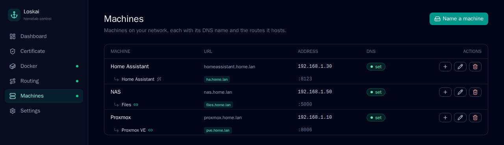

[Docs](../README.md) › [Guides](../README.md#guides)

# Using Loskai

**Read this when** the install is done and you want to know what each tab is for.

One section per tab, each with an example. The examples use `home.lan` as the base
domain and `192.168.10.20` as the Docker host.

## The idea in one paragraph

Every service gets a name like `jellyfin.home.lan`. **Caddy** answers that name and
forwards to the service (the *route*); **AdGuard** tells your devices where the name lives
(the *DNS rewrite*). Loskai does both in one step and remembers it in `data/instances.json`.
Nothing else is stored.

## Accounts

The first time you open Loskai it asks you to create the **admin** account — a username and a
password. In **Settings › Users** an admin adds more: another **admin**, who can do
everything, or an **operator**, given any of the Docker, Routing and Machines tabs and able
to do everything in those — and nothing else, Settings included. A route belongs to Routing,
so an operator without it can install an app but not give it a URL.

You stay signed in while a Loskai page is open, even in a background tab, and are signed
out 2 hours after you close the last one (an admin changes that in Settings › Security). **Log out** signs you out on every device. Your
name at the bottom of the sidebar opens **Your account**: your role and tabs, and your
password to change.

## Dashboard

A launcher: one card per routed service, public so the whole household can use it. Hide a
card with the eye on its Routing row; give it an icon with the image button on the same row.

## Certificate

Loskai's names use Caddy's own certificate authority, which your devices don't trust yet.
This page hands out that certificate with install steps per OS. Once per device — see
[certificate-setup.md](certificate-setup.md).

## Docker

Your containers, grouped by compose project.

- **Stacks** are the projects Loskai manages, in `stacks/<name>/`. Toggle up/down, restart,
  pull + update, edit, or delete — **Delete keeps `./data` unless you tick it**, so installing
  again picks the data back up. Edit opens as a form: **Settings** (the `.env`, labelled
  with the recipe's questions), **Folders** (host folder → path in the container, writable or
  not), the recipe's **Options** (a GPU for transcoding, say — off until ticked) and **App** —
  what `compose.yml` runs, shown but not edited, since it is the recipe's.
  **Edit as text** opens the files themselves, a tab each; switching either way keeps what
  you haven't saved yet. **Save** — greyed out until something changed — saves and
  re-ups the stack.

  > *Example:* to give Jellyfin another library, Edit → Add folder → `/srv/media/books` →
  > `/media/books` → Save.
- **Other containers** were started elsewhere (another compose folder, `docker run`).
  Start, stop and remove work; editing doesn't — the files aren't Loskai's.
- **Volumes** lists Docker volumes and which containers use them. An unused one can be
  deleted.

**Install recipe** opens the catalog. A recipe is a ready-made `compose.yml` plus the
questions it needs answered. **Check for updates** lists what you installed from recipes and
marks the ones whose recipe has a newer version: open one to see what changes, then Update.
Only the recipe's `compose.yml` is replaced — your answers and `compose.override.yml` stay.

> *Example:* pick **Jellyfin**, add your media folder, press Install. Loskai writes
> `stacks/jellyfin/`, runs it, and offers a prefix — type `jellyfin` and it is live at
> `https://jellyfin.home.lan`.

Recipes come from git repos listed in **Settings › General**, plus any you drop into
`data/recipes/` ([recipe-schema.md](../reference/recipe-schema.md)).

## Routing

Every web address Loskai serves. Each row has two statuses: **Route** (Caddy has it) and
**DNS** (AdGuard has it).

**Add route** offers three sources:

| Source | For | Example |
|---|---|---|
| Container | a container on this host | `whoami` → `whoami.home.lan` → `192.168.10.20:8081` |
| Network service | AdGuard, your router, Caddy itself | `adguard.home.lan` → AdGuard's web UI |
| External | anything else with an IP and port | `nas.home.lan` → `192.168.10.50:5000` |

A container route can **follow its container** (on by default when Loskai can work out its
address): if it comes back on another port, the route is updated. Per route you can also
pick **HTTPS** (the default), **HTTP** for a device that can't trust the certificate, or
**Both**.

The two pills at the top: **AdGuard** shows whether DNS is reachable, and has a one-click
button to route AdGuard's own UI; **Caddy** shows the address every name answers with.

## Machines

The computers on your network, by name — a name with no port.

> *Example:* name `192.168.10.177` **proxmox** and it gets `proxmox.home.lan`. Add a route
> for its web UI on port 8006 *on that machine*. When the host moves to `.180`, edit the
> machine once and the route moves with it.

Under each machine are the routes on its address — however they were made. A machine's
row opens and closes like a stack on the Docker tab, showing how many it holds while
closed. Moving the machine moves them all, except a container route that follows its
container.

The machine Loskai runs on is listed before you name it, as **Docker host**, from the
Docker host IP in Settings › General, with the routes on that address under it. **Name it**
(the tag on its row) opens Name a machine with its address filled in. Once it has a name
it is a machine like the others, with SSH, tools and its dialog.

The **cog** on a machine's row opens its dialog, laid out like a settings window: every
section in one scroll, and a menu down the side that jumps to one and marks where you are.
Its search finds a section by what is in it and shows only those.

- **General** — its machine name (what DNS answers for) and address, then what the machine says
  about itself: system, uptime, memory, disks, updates waiting, its Tailscale address.
- **SSH** — a switch beside the heading turns it on or off, each in a dialog that says what
  happens. Then its user and port, side by side; whether it is set up (and the button to set
  it up); and the **updates without a password** switch.
- **Tools**, **Running** and **Log** — below.

Each field saves when you press Enter or leave it, and Escape puts it back; a value that
isn't valid says why and saves nothing. A machine set up before the overview existed says
"install again" there — one click.

**Tools** add buttons to a machine's dialog — the ones that fit what the machine has, with
nothing to switch on, each as a card under its **Tools**. **System** updates it (with its own package manager), reboots it or shuts it down;
**Services** restarts or stops a service or container from the Running list; **Proxmox**
reboots or shuts down a running LXC or VM. Each runs in the machine's terminal, so you see
it; hovering a button shows the command. One that runs by itself — System's, Services,
Proxmox, ending a tmux session, Tailscale's Disconnect, adding a tool — asks first for
sudo's password in a dialog when sudo would, checks it on the machine, and closes its
terminal when it is done; a failure stays open with its exit code. The others (a shell,
tmux, Claude, Connect) answer sudo in the terminal as usual. With
`tmux` on the machine it keeps running if you close the tab, and clicking it again picks it
back up.

A tool the machine doesn't have yet is under **Add tool**, on the right of the Tools
heading — each says what it installs, and picking one installs it, in the terminal. The **Tools** button (the wrench) on the machine's row in the
Machines tab lists the added tools — tmux, Claude Code, Tailscale — with how each stands
there, and opens one in a dialog: the tool itself, or, if it isn't added yet, what it needs
and Add.

- **tmux** lists the machine's sessions — yours, and the ones Loskai's actions run in;
  Claude's are on their projects instead.
  **Attach** opens one in the terminal (detach with Ctrl+B, then D, and it keeps running),
  **End** ends it, and **New session** starts one with the name you type.
- **Tailscale** is installed with Tailscale's own installer. **Connect** brings it up — the
  first time, the terminal shows a link to log the machine in. The overview then shows
  its Tailscale address, and Tailscale's card lists your tailnet — each device, its
  address and OS, and whether it is online. In an LXC, Tailscale needs the container to have `/dev/net/tun`.

- **Git** holds who the commits made on the machine are by — its **Name** and **Email**,
  git's global `user.name` and `user.email`, read from the machine and set there as you
  edit them (with Loskai's key, so the card asks for your password while it is locked) —
  and the machine's **projects folder**, `~/projects` unless you change it (`~` or one
  folder in it).
- **Claude Code** lists the git projects in the machine's projects folder, set on the Git
  card (a tool's dialog has a **Settings** button there), with each one's
  branch, commits not pushed yet, uncommitted changes, last commit and when Claude last
  worked there. **Claude**
  opens it: the session already running there, else the last conversation continued,
  else a new one. It runs in tmux with **Remote Control** on, so after you close the tab
  you can carry on from the Claude app or claude.ai/code. **Terminal** is a shell in the
  project, **Pull** brings in what was pushed from elsewhere (only when it fast-forwards),
  **Push** sends your commits, and **End** stops its Claude — the conversation stays.
  **New project** makes the folder, starts a git repository and opens Claude in it.
  Claude Code has to be logged in on the machine — the first time, do that in the
  terminal. Loskai holds no Claude login.

A machine set up before a tool's facts existed asks you to **install again** in its dialog —
one click, and its overview comes back with them.

Give a machine an **SSH user** and Loskai sets up SSH to it right after you save: check the
host key it shows against the machine's, then type that user's password once and Loskai
installs its key (or copy its two lines over yourself). Its dialog does this again, under
SSH. Once it's set up, a terminal button sits on its row and in its dialog, and the row
gets **Update** (the download arrow) — System's update, run in that terminal. In it, what a program copies —
tmux, Claude Code's `c`, an editor — lands on your clipboard (a long URL whole, however it
wraps on screen); Shift+drag selects even where a program uses the mouse, and Ctrl+Shift+C
copies that. From then on the row shows how much
is **running** there — containers, your services and, on Proxmox, its VMs and LXCs — and
hovering lists them. On Proxmox, or where the user isn't in the `docker` group, give it
`sudo` for `docker ps`, `pct list` and `qm list` to see those.

**Updates without a password**: System's Update otherwise asks for the user's `sudo`
password in the terminal. Switching it on puts a sudo rule on the machine that lets Loskai's user
run exactly the update commands for its package manager — and nothing else — without one;
you give the password once, in the dialog, and it is used for that run only. Switching it
off removes it, with no password. It is not needed where Loskai logs in as root (Proxmox).

**Turning SSH off** (the switch on the SSH heading) takes Loskai's sudo rule and key off the
machine, as deleting it does, then its entry; the machine stays, by name. Turning it on asks
for the user and port, then opens the setup.

**Deleting** a machine is under the ⋮ on its row. A set-up one has Loskai's key taken off it first — its two lines in
`authorized_keys`, nothing else — so it asks for your password if the key is locked.
If the machine can't be reached it is deleted anyway, and Loskai tells you its lines are
still there. Adding it again later installs the same key again.

## Settings

- **General** — base domain, the Docker host's IP, recipe sources, export a backup.
- **Network** — where Caddy, AdGuard and WireGuard are, and who sees the Certificate page.
  Each service is optional: one that is unset or down greys out only its own part of the UI.
- **SSH** — Loskai's key (its fingerprint, New key), how long your password unlocks it
  (15 minutes unless you pick 1, 3, 8 or 24 hours), the SSH config for your own computer,
  and the log of terminals and installs.
- **Users** — the accounts: add one, set its role and tabs, set its password, remove it.
- **Security** — how long you stay signed in once no Loskai page is open (2 hours unless
  changed).

Settings is an admin's.

---

**Next:** something not working? [Troubleshooting →](troubleshooting.md)
